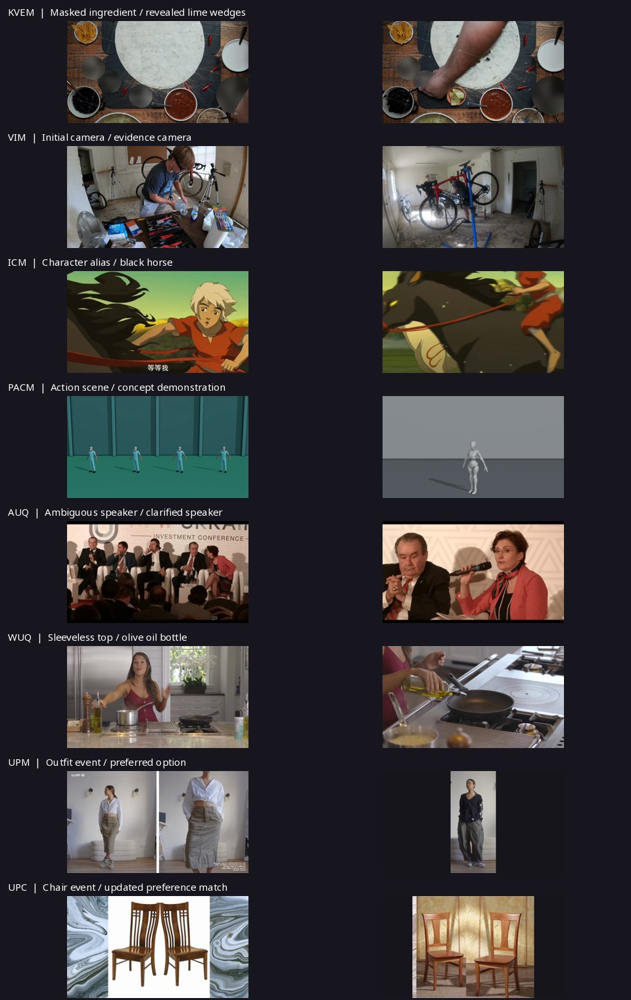

# Visual review of the eight benchmark examples

Reviewed against the locally supplied `pvb.streaming_dataset.v2` annotations on 2026-10-28. These are benchmark reference interactions, not recorded model runs. Source annotation checksums and media mappings are in `assets/examples/annotations.json` and `manifest.json`.

| Task / case | Selected turns | Visual checks |
| --- | --- | --- |
| KVEM_000018 | 1–2 | Burrito preparation: the requested near-edge bowl is masked in the input and reveals lime wedges at 15.80 s; the right-hand bowl reveals corn kernels at 35.37 s. Other masks remain in place. |
| VIM_000022 | 1–2 | Bicycle workshop: the initial camera does not show the requested wall-mounted air conditioner; both accepted cameras show it at 21.85 s. At 43.17 s the reference camera shows the brown noticeboard and two white papers hidden from the egocentric input. Initial cameras change between turns as specified by the source. |
| ICM_000006 | 1 | The supplied definition image matches the pale-haired character in a red shirt at 91.50 s. Frames at 100.60, 102, 104, and 106 s show that character riding the black horse. The definition assigns an alias; no real identity is inferred. |
| PACM_000001 | 1 | Compared original scene and concept-definition sequences at 3, 8, 13, 18, 23, 28, and 33 s. The leftmost performer matches the rightward step, arm opening, and crossover sequence. The original synthetic benchmark video is retained and attributed to its dataset. |
| AUQ_000014 | 1–2 | At 34.50 s several panelists occupy white chairs; at 48.24 s the woman speaks. At 84.22 s the man wearing the specified dotted tie speaks. Original open reminder answers and clarification replies are retained. |
| WUQ_000026 | 1 | At 63.06 s the magenta top is visibly sleeveless, contradicting the question's long-sleeve premise. At 70.49 s the woman holds and pours from an olive-oil bottle. |
| UPM_000020 | 1–3 | Checked outfit transitions at 70, 154.40, and 244.36 s against the queries and inspected each supplied correct-option image: floral sleeve graphics, cropped V-neck button-front blouse, and over-ear headphones. All candidate images are included for comparison. |
| UPC_000047 | 1–3 | Checked the chair transition at 32.75 s and title cards at 72.80 and 107.85 s. Correct-option images show the hourglass splat, light-gray finish, and curved horizontal backrest respectively. Earlier and updated preferences are both retained. |

Excerpts retain source time zero and all intervening frames. Selected turn counts vary with the source; no extra rounds, distractors, replies, or time windows are fabricated. Where the source has no fixed answering window, the interface preserves that fact and explains evidence-dependent answer timing. Visual checks are sampled checks of the selected events and evidence, not a frame-by-frame audit of the entire dataset.

Browser verification covers playback and timeline seeks in all eight cases and all 15 turns, reference videos/images, accepted action options, open answers, preference history, and automatic camera changes between VIM turns. Desktop and 390/768 px layouts were checked in Chromium. MP4 codec, duration, and local asset references were checked separately. Local previews require a server with HTTP byte-range support.
